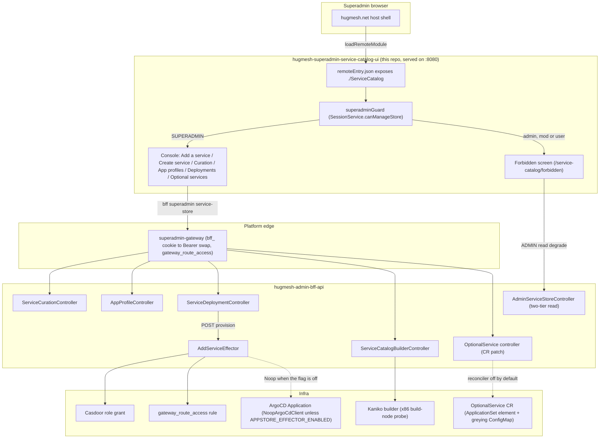

# hugmesh-superadmin-service-catalog-ui

The **Superadmin Service Catalog console** — an Angular **native-federation remote** that
the `hugmesh.net` host mounts at the apex path **`/service-catalog`** (the path this
code assumes; the deployed mount is `/superadmin/service-catalog`, see "Federation
contract"). It is the
SUPERADMIN console that makes the `hugmesh-admin-bff-api` Service Catalog **data
layer** (`feat/superadmin-service-catalog-data-layer`) usable: per-domain service
**curation**, **app-profile** deploy-template CRUD, **service-deployment**
lifecycle **accounting**, a **create-and-federate wizard** that scaffolds a
brand-new service from a starter archetype and optionally registers its UI into the
federation manifest, and an **optional-services** on/off toggle.

## Federation contract

The registration descriptor in `hugmesh-generator`
(`specs/cluster/manifests/federation-api/register-superadmin-service-catalog.descriptor.yaml`)
points the federation manifest at this remote:

| field | value |
| --- | --- |
| `remoteEntry` | `http://hugmesh-superadmin-service-catalog-ui.hugmesh-frontend.svc.cluster.local:8080/remoteEntry.json` |
| `mountAt` | `/superadmin/service-catalog` |
| `requiresRole` | `SUPERADMIN` |
| `kind` | `remote-shell` |
| `visibility` | `internal` |

The descriptor leaves the `federation_modules` INSERT to a `hugmesh-federation-api`
Liquibase changeset it names, `042-register-superadmin-service-catalog-module.xml`.
That changeset is not on `hugmesh-federation-api` `origin/main` (the changelog stops at
`041`), so the row may not exist on a mesh yet. The older values in the comment of
`federation.config.js` (short host name, `/service-catalog`, `superadmin`) differ from the
descriptor.

So this remote:

- exposes **`./ServiceCatalog`** (→ `src/app/service-catalog.routes.ts`, `SERVICE_CATALOG_ROUTES`) in
  `federation.config.js` under the remote name `service-catalog` — the module key a host
  passes to `loadRemoteModule`;
- is served on **port 8080** (see `Dockerfile` + `nginx.conf`,
  `nginxinc/nginx-unprivileged`) so the emitted `remoteEntry.json` is reachable
  at the registered URL;
- is **internal** — the SUPERADMIN infra control plane, reachable only behind the
  `ROLE_SUPERADMIN` route-access row for `/superadmin/service-catalog/**` on
  `hugmesh-superadmin-gateway` (`StripPrefix=2`) and the tailnet-only superadmin
  surface. It is **not** a public UI.

`federation-base.js` carries the same code as the `hugmesh-host-shell` copy (the
single source of truth for the shared-deps surface + RxJS skip list; only the header
comments differ) so this remote can't drift from the host or the other HugMesh remotes.

## Architecture

How a superadmin's click in this remote reaches a real (or ships-dark) cluster
mutation — the host mount, the auth edge, the BFF surface, and the two things
that gate on live infra (the effector's ArgoCD apply and the DOCKERFILE/ZIP
builder pre-flight):



The `BuilderCtl`/`Kaniko` leg (`GET /bff/superadmin/service-store/builder`) is
the live capability pre-flight — see "Add a service" below and
"BFF contract" for the exact path.

## Role model

Mirrors `hugmesh-admin-bff-api` (the Service Catalog controllers + `SecurityConfig`
path gates). The UI gating is defence-in-depth convenience; the bff
`@PreAuthorize` is authoritative — every call surfaces a 403 gracefully.

| capability | composite | views |
| --- | --- | --- |
| `canManageStore` | `SUPERADMIN` | Add a service, Create service, Curation, App profiles, Deployments, Optional services (the whole console) |
| `canReadOwnCatalog` | `ADMIN \| SUPERADMIN` | the two-tier read-only "my domain's offered catalog" degrade on the forbidden screen |

The **entire console is SUPERADMIN-only**: every `/bff/superadmin/service-store/**`
and `/bff/superadmin/app-profiles/**` endpoint (and `/bff/superadmin/optional-services/**`) is
`@PreAuthorize("hasRole('SUPERADMIN')")` AND walled at the coarse
`/bff/superadmin/** = hasRole('SUPERADMIN')` gate. An **admin/mod/user** is denied.
An **admin** still gets a graceful read-only landing on the forbidden screen via
the two-tier `GET /bff/admin/service-store` (`hasAnyRole('ADMIN','SUPERADMIN')`)
read of their own issuer-derived domain's offered catalog.

### Forbidden redirect (critical)

A denied child guard routes to **`router.parseUrl('/service-catalog/forbidden')`** — the
IN-REMOTE mount-path screen, **NOT** `'/forbidden'` and **NOT** `'/login'`. The
host already authgated the user in (route-access `/superadmin/service-catalog/**`); a denial
here is a **within-service privilege boundary**, not an auth failure. (Shipping the
bare `/forbidden` was a real wiki-ui bug — the mount-prefixed path is the correct
in-remote target.)

## BFF contract (the exact PR #56 surface this console wires)

`src/app/service-catalog.service.ts` calls these EXACT paths (asserted in
`service-catalog.service.spec.ts`):

| method | path | body | role |
| --- | --- | --- | --- |
| `GET` | `/bff/superadmin/service-store/{domain}` | — | SUPERADMIN |
| `POST` | `/bff/superadmin/service-store/{domain}/offer` | `{serviceKey}` (`X-ServiceStore-StepUp` when challenged) | SUPERADMIN |
| `POST` | `/bff/superadmin/service-store/{domain}/withdraw` | `{serviceKey}` (role-only: no step-up gate) | SUPERADMIN |
| `GET` | `/bff/superadmin/app-profiles` | — | SUPERADMIN |
| `GET` | `/bff/superadmin/app-profiles/{name}` | — | SUPERADMIN |
| `POST` | `/bff/superadmin/app-profiles` | `{name, profileJson}` | SUPERADMIN |
| `PUT` | `/bff/superadmin/app-profiles/{name}` | `{name, profileJson}` | SUPERADMIN |
| `DELETE` | `/bff/superadmin/app-profiles/{name}` | — | SUPERADMIN |
| `GET` | `/bff/superadmin/service-store/{domain}/deployments` | — | SUPERADMIN |
| `POST` | `/bff/superadmin/service-store/{domain}/deployments` | `{serviceKey, profileRef?, endingAt?, enforceActions?}` | SUPERADMIN |
| `POST` | `/bff/superadmin/service-store/{domain}/deployments/{id}/end` | — | SUPERADMIN |
| `POST` | `/bff/superadmin/service-store/{domain}/deployments/{id}/provision` | `{sourceKind, repoUrl, path?, targetRevision?}` (`X-ServiceStore-StepUp` when challenged) | SUPERADMIN |
| `GET` | `/bff/admin/service-store` | — | ADMIN \| SUPERADMIN |
| `GET` | `/bff/superadmin/service-store/builder` | — | SUPERADMIN |
| `GET` | `/bff/superadmin/service-store/scaffold/archetypes` | — | SUPERADMIN |
| `POST` | `/bff/superadmin/service-store/{domain}/scaffold` | `{serviceKey, displayName?, archetype, mountAt?, requiresRole?}` (`X-ServiceStore-StepUp`) | SUPERADMIN |
| `GET` | `/bff/superadmin/service-store/{domain}/scaffold/{id}/archive` | — (`application/zip`) | SUPERADMIN |
| `POST` | `/bff/superadmin/service-store/{domain}/deployments/{id}/federate` | `{slug, mountAt, exposedModule, remoteEntryUrl, kind?, visibility?, requiresRole?}` (`X-ServiceStore-StepUp`) | SUPERADMIN |
| `GET` | `/bff/superadmin/service-store/federation` | — | SUPERADMIN |
| `GET` | `/bff/superadmin/optional-services` | — | SUPERADMIN |
| `PUT` | `/bff/superadmin/optional-services/{slug}` | `{enabled, reason?}` | SUPERADMIN |

The `/provision` row is the **Service Catalog effector**
(`feat/superadmin-service-catalog-effector`): it drives an existing
`service_deployment` row from accounting-only into a real provisioned service
(per-service Casdoor role → route-access rule → ArgoCD `Application`). `sourceKind`
is one of the **four Service Catalog sources** — `SELECT` / `GIT` / `DOCKERFILE` / `ZIP`
(case-insensitive; null/blank → `SELECT`). `SELECT` (a catalog tile) and `GIT` (a
prebuilt repo) provision today; `DOCKERFILE` and `ZIP` need an image **built first**
by the in-cluster **Kaniko** builder (`KanikoBuildLauncher`). The bff answers
`{deployment, effectorReal}`; this console ignores the body and re-reads the rows.
The effector is **dark by default**: `app.appstore.effector.enabled` is `false` in the bff's
`application.yml` (`APPSTORE_EFFECTOR_ENABLED`), and then the `NoopArgoCdClient` makes no
real ArgoCD mutation and the call still returns `200`. The `hugmesh-generator` manifest
(`manifests/admin-bff-api/deployment.yaml`) sets `APPSTORE_EFFECTOR_ENABLED` to `"true"`, so on a
mesh deployed from it the real `RestArgoCdClient` is the wired bean. The manifest's
own note says that client currently fails at the TLS handshake against the self-signed
`argocd-server` (`hugmesh-admin-bff-api#62`). The bff also exposes
`GET .../service-store/effector` (`{real}`); this console does not call it.

The `/builder` row is the **live Kaniko-builder capability pre-flight**
(`ServiceCatalogBuilderController`): it reports
`{enabled, buildNodePresent, warnings}` — the `app.appstore.builder.enabled` config
flag AND a live, fail-safe x86 build-node probe. The Add-a-service view consults it
(alongside `requiresBuilder()`, the static per-kind fact) to un-gate `DOCKERFILE`/`ZIP`
the moment a real build is actually possible, instead of leaving them statically
disabled forever. A failed/loading pre-flight fails safe (never a faked "ready").

The `scaffold`/`archive`/`federate`/`federation` rows are the **create-and-federate
wizard** surface (`ServiceStoreWizardController`). `POST .../scaffold` and
`POST .../deployments/{id}/federate` are **step-up-gated**: each call carries a fresh
token in the `X-ServiceStore-StepUp` header (a fresh MFA stamp on the session also satisfies
the gate without a token), and a missing/expired one comes back as a
403 with the platform "requires step-up" contract (`ServiceCatalogApiError.isStepUpRequired`)
rather than an ordinary superadmin-denial 403. The `offer` and `provision` rows
are step-up-gated in the admin-bff too (`ServiceCurationController.offer`,
`ServiceDeploymentController.provision`; the same gate and the same MFA-stamp alternative).
`withdraw` is deliberately role-only (an operator decision recorded in
`ServiceCurationController`, hugmesh-generator #347 decision 6). The Curation and Add-a-service
views speak the **same client contract** (issue #4): they pause on
a "requires step-up" 403, show the shared `<hug-step-up-challenge>`, and retry the same call
with the confirmed token — carried through an `HttpContext` seam (`step-up-context.ts`) into
the header by `bffAuthInterceptor`. The seam is older than the bff gate: the generated
`offer` and `provision` clients now declare the header parameter, and only `withdraw` does not,
but the console still routes all three through the seam. A token-less call is byte-identical
to a call before the seam existed. `GET .../scaffold/{id}/archive` streams the
rendered starter codebase as a zip over the same `bff_` cookie (a plain anchor href, no
in-JS blob fetch). `POST .../federate` returns `{deployment, federationReal,
gitopsDescriptorPending}` **honestly**. `gitopsDescriptorPending` is always `true` today (the
GitOps descriptor automation does not exist). `federationReal` is `false` while the bff
wires the `NoopFederationModuleClient`, which is the default
(`app.appstore.federation.enabled`, `APPSTORE_FEDERATION_ENABLED`, `false` in `application.yml`).
The `hugmesh-generator` manifest sets that flag to `"true"`, which wires the
`RestFederationModuleClient`; per the manifest's note, that client fails at the TLS handshake
(`hugmesh-admin-bff-api#82`) and has no auth-token source. The wizard
renders the outcome as an explicit notice rather than faking success. `GET .../federation` is the
live pre-flight the federation step consults up front (`enabled` + `warnings`), mirroring
how the builder pre-flight gates DOCKERFILE/ZIP.

The `{domain}` is always the explicit **path** target (never a body field) — the
infra control plane picks the brand. The two-tier admin read resolves the domain
from the validated JWT issuer, never the request.

The two `optional-services` rows are the **post-deploy service toggle** (the
`Optional services` view below). They are the ONLY calls in this service that do not go
through the generated `ng-openapi-gen` client:
`listOptionalServices()` / `setOptionalServiceEnabled()` call `HttpClient` directly. The
admin-bff handler exists (`OptionalServiceSuperadminController`), the committed `openapi.json`
lists both paths, and a generated `OptionalServiceSuperadminControllerService` exists, but
the service does not use it. They
hit the same same-origin `/bff/**` path through the same `bffAuthInterceptor`, and
`service-catalog.service.spec.ts` asserts URL + method + body + credentials, so switching
them to the generated client is a no-op for the
contract. **This UI half has not been exercised against a running admin-bff** — see
"Known Gaps".

`GET` returns the envelope `{reconcilerEnabled, services[], note}` (a bare array is also
accepted). With the reconciler off, `PUT` answers `503` with `dark: true` and writes nothing;
an unknown slug is `404`; a slug the registry cannot actuate is `422` with the named reason.
The response shape this console reads is deliberately two-valued per service:
`enabled` is the **requested** `spec.enabled`, and `installed` is the **confirmed**
`status.installed` the controller reports it actually wrote. Everything the screen claims
about a service's state is derived from `installed` alone; `toggleable` (+ `reason`) tells
the console whether the server can actuate that slug at all. A row that omits `installed`
reads as *not confirmed*, and a row that omits `toggleable` is treated as **not**
toggleable — both fail safe, loudly.

## The console

- **Add a service** — the headline flow: type/select a domain, load its recorded
  deployments (its app profile), pick one, then choose one of the **four sources** —
  **Catalog (SELECT)**, **Git / GitLab (GIT)**, **Dockerfile (DOCKERFILE)** or **Zip
  repo (ZIP)** — and **Provision** it (`POST .../deployments/{id}/provision`). SELECT
  and GIT provision today. DOCKERFILE and ZIP are gated on the **live builder
  pre-flight** (`GET .../service-store/builder`): the view fetches it
  alongside each domain load and un-gates those two sources automatically the
  moment it confirms a real in-cluster build is possible (the config flag enabled
  AND a build node actually present) — it does not wait for a redeploy. The
  `hugmesh-generator` admin-bff manifest sets `APPSTORE_BUILDER_ENABLED` to `"false"`
  (`manifests/admin-bff-api/deployment.yaml`), so on a mesh deployed from it the
  pre-flight reports "not ready" (UNVERIFIED on a live mesh), so in practice SELECT/GIT are the only sources that provision; the radio
  options render disabled with help text explaining *why* (not enabled vs.
  enabled-but-no-build-node). The submit is guarded defence-in-depth, and the
  bff's authoritative `400` is surfaced verbatim. `repoUrl` is required (the bff
  `@NotBlank`); `path`/`targetRevision` are optional. The `{domain}` and `{id}`
  are the explicit PATH targets.
- **Create service** — a five-step wizard (**Identity → Archetype → Source →
  Federation → Review & apply**) that stands up a brand-new service from scratch and
  optionally federates its UI, over the `ServiceStoreWizardController`:
  - **Identity** — domain, `serviceKey`, display name, optional app-profile reference.
  - **Archetype** — pick a starter codebase from the embedded catalog
    (`GET .../scaffold/archetypes`); the view validates the derived slug against the
    per-archetype rule (e.g. the spring-bff archetype needs a Java-package-safe
    `^[a-z0-9]+$` slug) before submit.
  - **Source** — the same four SELECT/GIT/DOCKERFILE/ZIP options as Add a service,
    sharing the exact same live builder pre-flight gating (`service-source-options.ts`).
  - **Federation** — slug/mountAt/exposedModule/remoteEntryUrl/visibility/requiresRole,
    with the live `GET .../federation` pre-flight shown as a ships-dark note when
    registration isn't real yet.
  - **Review & apply** — an optional "offer to the domain catalog" toggle, then runs the
    apply chain **sequentially**, each step surfaced with its own status: offer? → record
    deployment → scaffold → \[archive download link] → provision → federate? (offer and federate
    are skipped when not chosen). `scaffold`
    and `federate` are **step-up-gated**: a 403 with the "requires step-up" contract pauses
    the chain and shows a token challenge; confirming a token **resumes the same chain**
    from the paused step. A bff `400` is surfaced verbatim, and the federate outcome's
    `federationReal=false` / `gitopsDescriptorPending=true` are rendered as explicit
    pending/dark notices — the wizard never fakes success.
- **Curation** — type/select a domain, load its offered catalog, and offer or
  withdraw a `service_key` for it. Shows the current offered set per domain.
- **App profiles** — CRUD the global deploy-template library (a name + a JSON
  document of resource/role/cert/exposure defaults). The editor validates the
  document against the committed schema `schemas/app-profile.schema.json` before
  saving (`src/app/app-profile-schema.ts` interprets that file; nothing is
  hard-coded): sections `resources` / `roles` / `certs` / `exposure`, every
  object closed (an unknown field is refused and named), every refusal listed
  with its dotted field path. **The server validates it too**: on
  `hugmesh-admin-bff-api` `origin/main` `AppProfileService.create` and `update`
  check `profileJson` against a byte-identical copy of this schema before the write
  (`hugmesh-admin-bff-api#55`, closed), so a direct API call or a stale tab cannot store
  a body the console would refuse. The values are stored verbatim and not resolved
  yet (a later effector reads them; issue #3).
  - **Operator decision 37 (2026-09-17, hugmesh-generator#347) RATIFIED the three
    choices this schema had to make on its own**: `roles[]` are Casdoor
    `ROLE_<UPPER>` names (37a, *not* the per-service `requiresRole` slug), unknown
    keys are STRICT (37b, `additionalProperties: false` everywhere), and
    `exposure.mfaRequired` stays (37c). `src/app/app-profile-schema.decision37.spec.ts`
    pins all three, so a later change cannot quietly take the branch the operator
    declined.
  - **The schema file is a two-repo contract.** Ratification un-parked
    `hugmesh-admin-bff-api#55`, which commits a **byte-identical** copy at
    `src/main/resources/schema/app-profile.schema.json` (`cmp` confirms the two files are
    identical today) and validates saves against
    it. `npm run verify:schema` (which runs first inside `npm test`, so CI enforces
    it) guards that with **two checks, and it is worth knowing which does what**:
    - a **local sha256 pin**, so the schema cannot be edited without also moving a
      literal. On its own this proves nothing about the other repo — moving the
      schema and the literal together in ONE repo satisfies it completely. That was
      a real hole, not a hypothetical: widening `certs.ttl` `maxLength` 32 → 64 here
      and moving only this repo's pin left **both** suites green with the files
      diverged (`cmp` → `differ: char 4898, line 63`).
    - the **mirror check**, which reads the BFF's copy and compares the two files
      byte for byte. This is the one that enforces the contract. It runs whenever
      `hugmesh-admin-bff-api` is checked out beside this repo, and in CI, where
      `.gitlab-ci.yml` clones it and sets `HUGMESH_SCHEMA_MIRROR_REQUIRED=1` so a
      failed clone fails the job instead of silently skipping. Point it somewhere
      else with `ADMIN_BFF_SCHEMA=<bff>/src/main/resources/schema/app-profile.schema.json`.

    So: editing the schema on one side turns both suites red **wherever the mirror
    check runs** — always in CI, always on a developer box with both checkouts. When
    the BFF is not readable the script says `mirror NOT VERIFIED` and means it.
- **Deployments (accounting)** — view the `service_deployment` rows (service,
  state `active|ended`, `created_at`, `ending_at` expiry clock, `enforce_actions`,
  `propagation_state`) and **record** a deployment (`serviceKey` + optional
  profile + optional `ending_at` + optional `enforce_actions`), or **end** an active one. This view is
  **catalog + accounting + lifecycle only** — recording a deployment here does
  not itself provision anything, and ending one tears nothing down (the bff's
  `ServiceDeploymentService.end` has no real teardown yet). Provisioning (the
  `AddService` effector) happens from the **Add a service** tab above (SELECT/GIT
  provision today; DOCKERFILE/ZIP stay gated on the live builder pre-flight).

- **Optional services** — the post-deploy on/off control for the optional cluster
  services (`GET`/`PUT /bff/superadmin/optional-services`). An image ships with only
  the services it was built with; this view is where a superadmin enables the rest.
  It is built to be unable to overstate what it knows:
  - The controls are two explicit **actions** (Enable / Disable), not a switch whose
    position mirrors state. State is a separate read-only badge derived **only** from
    the controller-reported `installed` — so an accepted request can never move it.
    A `PUT` returning `2xx` produces a notice worded as a *request*, and the row stays
    *Not confirmed* until the controller reports it.
  - *Not confirmed* is a first-class reading, with the cause named (never observed vs.
    a stale `observedGeneration`). This is what a slug the reconciler silently ignores
    actually looks like, and the view makes it visible instead of showing it as on.
  - A slug the server reports as **not toggleable** — or does not report on — has both
    actions disabled with the server's reason rendered beside them and wired via
    `aria-describedby`. Every disabled action on the screen carries a reason; there is
    no bare disabled control.
  - A failed `PUT` renders the server's message **verbatim** alongside the
    plain-language prefix, never instead of it.
  - Unlike every other view here, a `403`/`404` on the load does **not** degrade to an
    empty state: "this domain offers nothing" is a truthful empty reading, "this mesh has
    no optional services" never is. A denied or missing endpoint is explained instead.

Every view has loading / empty / error states; a 403/404 degrades gracefully (with the
one deliberate exception noted under "Optional services").

## Typed API client (ng-openapi-gen)

The typed client under `src/app/api/` is **committed** (generated by `ng-openapi-gen`
from the admin-bff-api OpenAPI spec, also committed here as `openapi.json`), so the
build is deterministic — no network, no running BFF.

Regenerate with:

```bash
npm run gen:spec   # copies ../hugmesh-admin-bff-api/src/main/resources/openapi/openapi.json
                   # → openapi.json, then runs ng-openapi-gen. Override the source with
                   # ADMIN_BFF_SPEC=/path/to/openapi.json. The BFF dumps that spec from
                   # `./mvnw -Dtest=OpenApiSpecDumpTest test`.
npm run gen        # just run ng-openapi-gen against the already-present openapi.json
```

`service-catalog.service.ts` is the thin **delegating** wrapper over the generated,
typed clients (`ServiceCurationControllerService` / `AppProfileControllerService` /
`ServiceDeploymentControllerService` / `AdminServiceStoreControllerService`, plus the builder and
wizard clients). It keeps
its OWN public `ServiceCuration` / `AppProfile` / `ServiceDeployment` /
`ServiceCatalogApiError` types — the stable contract the views consume — and bridges
the generated models at the delegation boundary. The generated clients call the SAME
same-origin `/bff/**` paths (`rootUrl` defaults to `''`); `bffAuthInterceptor`
(`src/app/auth.interceptor.ts`) authenticates every request with `withCredentials: true`
so the browser's HttpOnly `bff_` cookie rides along — it does **not** attach a
bearer token read from `hug.session` (that browser-held bearer was removed;
see "Auth & session model").

> **ng-openapi-gen 1.0.5 generates `Promise<T>` methods in `src/app/api/services/` (the
> `fn/` helpers still return `Observable`)**; the
> `service-catalog.service.ts` delegation layer is written in async/await to match. The public API/types surface (`ServiceCuration` / `AppProfile` /
> `ServiceDeployment` / `ServiceCatalogApiError`) is unchanged — only the internal
> delegation is async/await.

## Auth & session model

This remote does **no** login of its own — the host shell authgates the superadmin
in and owns the session. Across the platform, **Casdoor** is the SSO IdP: `login-ui`
runs the Casdoor OIDC authorization-code (PKCE) redirect and `user-bff` does the
server-side code→token exchange and holds per-session JWT custody/refresh. The
browser only ever holds an **opaque `bff_`-prefixed session** (the `hug.session`
entry in `localStorage` this remote reads for roles; the `bff_` cookie itself is HttpOnly) — the
superadmin never sees their own Casdoor JWT.

At the edge the **gateway** is a pure Casdoor-JWT OAuth2 resource server: a
pre-security exchange filter swaps the `bff_` session for the internal custody JWT
so the gateway's JWT validation + role gate run unchanged. Authorization is
data-driven by the `gateway_route_access` Postgres table (source of truth) via
`GatewayRouteAccessFilter`; the `/superadmin/service-catalog/**` and
`/bff/superadmin/**` rules (`ROLE_SUPERADMIN`) live there, with SUPERADMIN granted
cross-domain reach. The bff `@PreAuthorize` remains authoritative; this UI's gating
is defence-in-depth.

## Current State

- **Console shipped** — the SUPERADMIN Service Catalog remote (Add a service /
  Create service / Curation / App profiles / Deployments / Optional services) is wired against the
  committed `openapi.json` typed client; karma tests + the Playwright/BDD e2e harness
  are merged to `main`. The harness has 37 `Scenario` / `Scenario Outline` blocks in 11
  `.feature` files, and every file carries the `@cluster` tag at Feature level, so all of
  them **SKIP** unless `E2E_CLUSTER=1` (the remote
  served at a `baseURL` + a reachable admin-bff `/bff/superadmin/service-store`).
  The offline contract is proven by the Karma specs.
- **Create-and-federate wizard shipped, scaffold + federate honest about being dark** —
  the five-step wizard's apply chain runs for real (offer/record/provision are the
  same live calls as "Add a service"), but `scaffold` and `federate` are step-up-gated
  and their outcomes are honestly reported: the archive is a real rendered
  zip, but `federateDeployment()`'s result always carries `gitopsDescriptorPending`
  until the GitOps descriptor automation exists, and `federationReal` stays `false`
  while the admin-bff wires its `NoopFederationModuleClient` (the packaged default;
  see "BFF contract" for the generator manifest, which enables the real client).
- **Optional-services toggle screen shipped, UNINTEGRATED** — the sixth console view
  (`/service-catalog/optional-services`) is wired against the
  `GET`/`PUT /bff/superadmin/optional-services` handler that now exists in the admin-bff
  and is covered by karma specs, but
  it has never been run against a live admin-bff and the reconciler behind it is off.
  See "Known Gaps" for exactly what is and is not proven.
- **Effector wired, dark by default** — `/provision` drives the Casdoor role +
  `gateway_route_access` leg and the ArgoCD apply. The packaged default is a `NoopArgoCdClient`
  (`app.appstore.effector.enabled=false`); the generator manifest sets the flag to `"true"`,
  where the real client fails at TLS (`hugmesh-admin-bff-api#62`). `SELECT` and `GIT` are the sources that provision.
- **Live builder capability gating shipped** — the in-cluster **Kaniko**
  builder (`KanikoBuildLauncher`) is available in the admin-bff behind
  `app.appstore.builder.enabled`, and `DOCKERFILE`/`ZIP` are no longer a static always-disabled pair: the
  Add-a-service view consults the live `GET /bff/superadmin/service-store/builder`
  pre-flight (the `app.appstore.builder.enabled` config flag + a fail-safe x86
  build-node probe, `ServiceCatalogBuilderController`) and un-gates them
  automatically once a real build is confirmed possible. The generator manifest sets the
  flag to `"false"`, so the pre-flight reports "not ready" on a mesh deployed from it
  and only `SELECT`/`GIT` provision in practice — but that is now a
  live signal, not a hardcoded gate.
- **Auth baseline current** — consumes the opaque `bff_` session model with Casdoor
  SSO at the edge; route-access is data-driven via `gateway_route_access`. No login
  logic lives here (login is `login-ui` + `user-bff`; account/session/MFA shared
  infra is in `hugmesh-auth-core`). Aligned with the **Java 25** / Spring Boot 4.0.7 /
  Spring Cloud 2025.1.2 / Spring Cloud Gateway 5.0 (`spring.cloud.gateway.server.webflux.routes`)
  backend baseline. The admin-bff is built against **hugmesh-parent 2.8.0**, which
  manages **hugmesh-commons 2.1.0**. CI is **GitLab** (`.gitlab-ci.yml`: `test`, `headers`,
  `build:image`); the only GitHub Actions workflow is `.github/workflows/release.yml`,
  manual (`workflow_dispatch`) and not wired to push or tags, which pushes the image to GHCR.
  **Angular 22** (`@angular/core` 22.0.2, `@angular/cli` 22.0.4, native-federation 22.0.1,
  ng-openapi-gen 1.0.5, per `package-lock.json`).
- **Internal-only surface** — served on 8080 as a native-federation remote behind
  the gateway superadmin gate and the tailnet-only superadmin surface. The
  `nginx.conf` ships baseline HTTP security headers (`X-Content-Type-Options: nosniff`,
  `X-Frame-Options: DENY`, `Referrer-Policy: strict-origin-when-cross-origin`, HSTS),
  emitted `always` and repeated per `location` (nginx drops inherited `add_header`s
  in a location with its own), plus the shared **strong nonce-based
  Content-Security-Policy** (ported from admin-ui/login-ui): a `map $request_id
  $cspnonce` per-request nonce, a `sub_filter` that rewrites every `<script` in
  the served `index.html` to carry `nonce="$cspnonce"`, and a
  `Content-Security-Policy` header with NO `unsafe-inline` in `script-src`
  (only `'self' 'nonce-…' blob:`; `style-src` keeps `'unsafe-inline'` because
  Angular inlines component styles). Since issue #5 it also ships
  `Cross-Origin-Embedder-Policy: require-corp`, `Cross-Origin-Resource-Policy:
  same-origin` and a `Permissions-Policy` denying 23 features — structure ported from
  `hugmesh-games/frontend/nginx.conf` (the only nginx front in the org that already
  shipped all three), values re-derived for this console. Those 23 are the features
  this console could plausibly reach, NOT every feature the browser knows about:
  `document.featurePolicy.features()` on Chrome 149.0.7827.55 returns **82** names, and
  the other 59 — client hints, the Privacy Sandbox set, `clipboard-read` /
  `clipboard-write`, `window-management`, `storage-access` — are left unrestricted.
  What IS measured is the narrower claim the guards pin: every one of the 23 shipped
  names is present in that list, so the header logs no `Unrecognized feature` noise
  (which `verify:page` fails on). `same-origin` rather than games' `same-site`: the
  superadmin gateway mounts this console at a path on its OWN origin
  (`/superadmin/service-catalog/**`, `StripPrefix=2`), the host shell refuses a cross-origin `remoteEntry` outright, and
  `hugmesh-gateway`'s own `SecurityConfig` already defaults every proxied response to
  CORP `same-origin` — so this only makes explicit at the origin what the edge
  already asserted. Empty `()` allowlists rather than games' `(self)` grants: this
  console has no camera / microphone / geolocation / fullscreen / WebAuthn code path.
  COOP stays the gateway's (`same-origin`, set at the TLS edge); COEP is enforced here
  because the gateway deliberately declines it platform-wide (it would break
  module-federation remotes that are not CORP-tagged) and this remote's subresources
  are all same-origin. Two guards pin it — `npm run verify:headers` (static, per
  BLOCK, plus the `ngCspNonce` marker in `src/index.html` that the conf's sub_filters
  rewrite; also run inside the image build) and `npm run verify:page` (headless Chrome
  over the real conf; CI `headers` job, which `build:image` needs, so a red one blocks
  the push rather than merely reddening the pipeline).

## Roadmap

- **Enable the effector for real** — `app.appstore.effector.enabled` is already `"true"` in the
  generator manifest, so what is left is making the call work: the ArgoCD client must trust
  the self-signed `argocd-server` certificate (`hugmesh-admin-bff-api#62`) and have an auth
  token (`APPSTORE_ARGOCD_AUTH_TOKEN` has no source in the tree). Then validate the
  provision path live.
- **Deploy a live Kaniko builder** — the UI side of DOCKERFILE/ZIP is done (the
  live pre-flight in "Current State" un-gates them automatically); what's left is
  infra-side, on the admin-bff/cluster: flip `app.appstore.builder.enabled` and
  land a node labelled `hugmesh.net/build-node=true` somewhere the pre-flight can see, then
  build-from-source services provision with no further UI change. The generator's own
  note says the flag flips only after the push-credential ExternalSecret lands.
- **App-profile resolution** — a later effector that reads the app-profile JSON
  (resource/role/cert/exposure defaults, in the shape `schemas/app-profile.schema.json`
  defines) instead of storing it opaque (issue #3, admin-bff work; the bff's
  `AppProfileService` says nothing reads the values yet). The bff validates the schema on
  save already; the profiles form shows a bff 400 reason verbatim — both bff
  error bodies surface: `{error}` (ApiException) and the bean-validation
  `{error:"validation failed", fields:{...}}`, which `ServiceCatalogService` folds into one
  message, so a path-keyed `fields` map (`resources.cpu: …`) renders field by field.
- **MFA step-up** — the bff gate (`ServiceStoreStepUpGate`) now covers `offer`,
  `provision`, `scaffold` and `federate`; `withdraw` stays role-only by operator decision.
  The UI half is in place for all of them (the same pause/challenge/retry the wizard uses,
  see above). Issue #4 is still open. What remains on this side: the generated clients for
  `offer` and `provision` already declare the header, so the `HttpContext` seam
  (`step-up-context.ts`) can be dropped for them.
- **Enable real federation registration** — the `RestFederationModuleClient` exists and the
  generator manifest enables it, but it fails at the TLS handshake
  (`hugmesh-admin-bff-api#82`) and has no auth-token source; the GitOps descriptor
  automation does not exist, so `gitopsDescriptorPending` stays `true`. Until then the wizard's
  `federate` step cannot register a new remote's UI.
- **Make the optional-services toggle actuate** — the admin-bff handler is in. What
  stays: switch the reconciler on (`APP_OPTIONAL_SERVICES_RECONCILE_ENABLED` is declared as
  `"false"` in `manifests/admin-bff-api/deployment.yaml`; the generator's decision is that it
  flips by a reviewed commit, and only after the cut-over in `docs/OPTIONAL-SERVICES.md` §10),
  and run this view against a live admin-bff. Until then this view is an honest window plus a
  request button, and a `PUT` is refused with `503`.

## Known Gaps / TODO

Verified directly against the current source (not from the roadmap narrative alone):

- **The optional-services view has NEVER been run against a live admin-bff.** The
  UI was first written to the documented contract (`hugmesh-generator`
  `docs/OPTIONAL-SERVICES.md` §10 "natural next wave"), then corrected against the body the
  bff builds (`{reconcilerEnabled, services[], note}`, commit `da8b5ce`), and is proven only
  against Angular's `HttpTestingController`. Nothing here has exchanged a
  byte with a running server. If the shipped DTO differs, the view fails **safe**, not
  silently: an unknown field is dropped, a missing `installed` reads as *not confirmed*,
  a missing `toggleable` disables the row with "the server did not report whether this
  service can be toggled", and a body that is neither an array nor an object with a
  `services` array raises rather than rendering an empty
  mesh. First integration should diff the real payload against
  `OptionalServiceView` in `src/app/optional-service-state.ts`.
- **The view discards `reconcilerEnabled`.** `listOptionalServices()` returns only the rows;
  `listOptionalServiceCatalogue()` keeps the envelope but nothing calls it. A superadmin
  learns the reconciler is off only from the `503` on a `PUT`.
- **The gateway route + `ROLE_SUPERADMIN` floor for `/bff/superadmin/optional-services`
  already exist** (the `/bff/superadmin/**` rows in the generator's route-access seed), so no new
  `gateway_route_access` row is needed for this view.
- **The admin-bff reconciler is off and the only way to turn it on is a reviewed commit.**
  `APP_OPTIONAL_SERVICES_RECONCILE_ENABLED` is declared in
  `specs/cluster/manifests/admin-bff-api/deployment.yaml` with value `"false"`, and
  `specs/cluster/apps/31-admin-bff-api.yaml` carries `automated:{prune:true,selfHeal:true}` with
  no `ignoreDifferences` on purpose (its header explains why), so a manual `kubectl set env`
  is reverted on the next selfHeal pass. **With the flag off the bff refuses a toggle** (`503`,
  `dark: true`, no write), and the view shows the server's message.
- **The three data defects recorded earlier are closed** (by the generator's
  slug-closure guard, `tests/scripts/test-optional-service-slug-closure.sh`): `character-forge`
  and `meshbridge` are now in the CRD `spec.slug` enum, the seed CRs and the admin-bff
  `OptionalServiceRegistry` (14 entries), and
  `specs/cluster/apps/16-reserved-prefixes-policy.yaml` lists 14 `ignoreDifferences`
  jsonPointers that include both. `headwind` and `attestation-server` are deliberately not
  toggleable (no 13a element; the registry reports them `NO_APPLICATIONSET_ELEMENT`), so
  they read as not toggleable in this view.
- **The `installed-services` ConfigMap is WRITE-ONLY.** No manifest under
  `specs/cluster/manifests` in `hugmesh-generator` mounts it or references it through
  `configMapKeyRef` or `envFrom`; the user-facing greying reads `federation_modules` in
  Postgres instead. Half of every reconcile pass therefore writes an artefact with no
  consumer. Recorded, deliberately **not** "fixed" by inventing a consumer. (The earlier
  org-wide grep count is not reproduced here.)
- **This repo has no i18n pipeline**, so no extraction was run for the new view. There is
  no `@angular/localize` dependency, no `extract-i18n` architect target in `angular.json`,
  and no `i18n=`/`$localize` usage anywhere under `src/` — all copy in all six views is
  inline English. The new view matches that; introducing `$localize` here would be a new
  pattern for one screen.
- **`DOCKERFILE` / `ZIP` provisioning sources need a live in-cluster builder that
  doesn't exist on any deployment yet** — `requiresBuilder()` is the static
  per-kind fact (`src/app/service-catalog.service.ts`), but it
  is combined with the LIVE `BuilderStatus`/`builderReady()` signal
  (same file, fetched by `builderStatus()`) to decide `opt.builderGated`;
  the add-service form (`service-catalog-add-service.component.html`) renders the gated
  options disabled with a help text that explains why.
  Only `SELECT`/`GIT` provision today, but the gate itself is now live/automatic,
  not hardcoded — see "Current State".
- **The Add-a-service notice does not follow the effector flag** — after a successful
  `/provision` the view always says the ArgoCD apply "lands when the effector is enabled (it
  ships dark by default)" (`service-catalog-add-service.component.ts`, `runProvision`). The bff
  returns `effectorReal` in the response; the console ignores it. On a mesh where the effector
  is enabled the notice is wrong.
- **Effector: the ArgoCD leg is dark by default and broken when enabled** — the provision
  call is wired end-to-end (role + route-access), but the packaged default is the bff's
  `NoopArgoCdClient` (no ArgoCD `Application` apply), and with the flag on the real client
  fails at TLS (`hugmesh-admin-bff-api#62`). See "BFF contract".
- **Create-service wizard's federate step does not register anything yet** —
  `federateDeployment()` (`src/app/service-catalog.service.ts`) returns
  `federationReal=false` while the bff's `NoopFederationModuleClient` is wired (and the
  enabled real client fails at TLS, `hugmesh-admin-bff-api#82`), and
  `gitopsDescriptorPending=true` until the GitOps descriptor automation exists; the
  wizard's Review & apply step renders both as explicit dark/pending notices rather than
  a completed federation (`service-catalog-create-service.component.ts`).
- **App-profile JSON is validated in the browser AND by the bff, but not yet resolved** —
  the editor refuses a document that does not match `schemas/app-profile.schema.json`
  (unknown field, wrong type, value outside its pattern/range) and names every offending
  field; `AppProfileService.create/update` in the bff re-check it before the write. Reads
  are not validated: a profile stored
  before the schema existed (the flat `{"cpu","memory"}` form) stays readable, shows its field errors the
  moment it is opened for edit and cannot be saved until it is moved under `resources`
  (`src/app/service-catalog-profiles.component.ts`). The effector that resolves the
  resource/role/cert/exposure defaults is issue #3 (admin-bff work).
- **Deployment lifecycle is accounting-only** — recording/ending a `service_deployment`
  row does not itself provision or tear down a real service; provisioning is the separate
  `AddService`/provision effector path (`service-catalog-deployments.component.ts`), and the
  bff has no teardown on end yet.
- **The mount path differs between code and platform** — the routes, the guard and the
  forbidden redirect hard-code `/service-catalog/...`, while the generator's descriptor and the
  superadmin gateway mount the console at `/superadmin/service-catalog`. The generator's
  gateway strips two segments, so the remote itself is served from `/`; whether a host
  mounting it at `/superadmin/service-catalog` still lands a denied user on
  `/service-catalog/forbidden` is not tested here.
- **Optional-services calls still bypass the generated client** — an open PR in this repo
  (#24) moves them onto it.
- **COOP is the gateway's, not this image's** — CSP, COEP, CORP and
  Permissions-Policy all ship in `nginx.conf` as of issue #5 (see "Current State"),
  but `Cross-Origin-Opener-Policy` is emitted by `hugmesh-gateway` at the TLS edge and
  is therefore absent on a direct in-cluster pod hit. Nothing here uses
  `SharedArrayBuffer`, so the console is not cross-origin ISOLATED and does not need
  to be; COEP enforces the subresource opt-in on its own.

No `TODO`/`FIXME`/stub markers were found in the hand-written `src/app` source
(the API client under `src/app/api/` is generated and excluded from this audit);
the gaps above are the ones the code and its own doc comments explicitly call out
as not-yet-done.

## Develop

```bash
npm ci
npm start          # ng serve service-catalog — standalone dev shell at /service-catalog
npm run build      # ng build service-catalog — dist/service-catalog/browser (remoteEntry.json exposes ./ServiceCatalog)
npm test           # headless karma (ChromeHeadlessCI)
npm run verify:artefact   # assert the BUILT exposed chunk really carries every route
npm run verify:headers    # assert nginx.conf's response-header contract, per BLOCK
npm run verify:page       # load the BUILT page in headless Chrome behind the real
                          # nginx.conf: nothing blocked, console clean, COEP +
                          # Permissions-Policy proven ENFORCED (needs chromium +
                          # openssl; --server=replay when there is no docker)
npm run build:verify      # build, then verify the artefact AND the headers
```

### e2e

`e2e/` is a separate npm package (its own `package.json`): a Playwright + playwright-bdd harness
(`.feature` Gherkin specs under `e2e/features/`, step defs under
`e2e/features/steps/`). Ships dark — the `@cluster`-tagged scenarios (see
"Current State" above) skip unless `E2E_CLUSTER=1` points at a live remote +
reachable `/bff/superadmin/service-store`; a plain run only proves the Gherkin
compiles and every step is bound.

```bash
cd e2e
npm install
npm run bdd        # bddgen (generate specs from .feature files) + playwright test
```

Per-user `E2E_<ROLE>_PASSWORD` / shared `E2E_PASSWORD` env vars are optional
overrides, not requirements: `e2e/tests/helpers/roles.ts` (`passwordFor()`)
falls back to the run-state `.e2e-credentials` file written by
hugmesh-generator's `make stack-seed` (`$E2E_CREDENTIALS_FILE`, or a
`.e2e-credentials` found by walking up from cwd). There is no built-in literal
password — if nothing resolves, the suite throws naming `make stack-seed`
rather than silently authenticating with a guessable default. Only the
`@cluster` scenarios' real host-shell login (`login()`) resolves a password,
at call time, so `playwright test --list` and a plain (skipping) run need no
credentials at all.

## Accessibility

Cross-repo HugMesh UI standard: every interactive control has a programmatic
accessible name (`accessible-name.ts` + spec), keyboard nav (the console menubar
is a roving-tabindex WAI-ARIA menubar), `disabled` + help text where relevant,
ARIA roles, visible focus rings, and loading/empty/error states announced via
`role="status"`/`role="alert"`.
